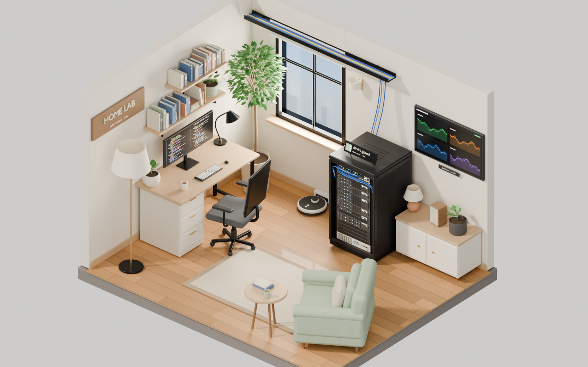
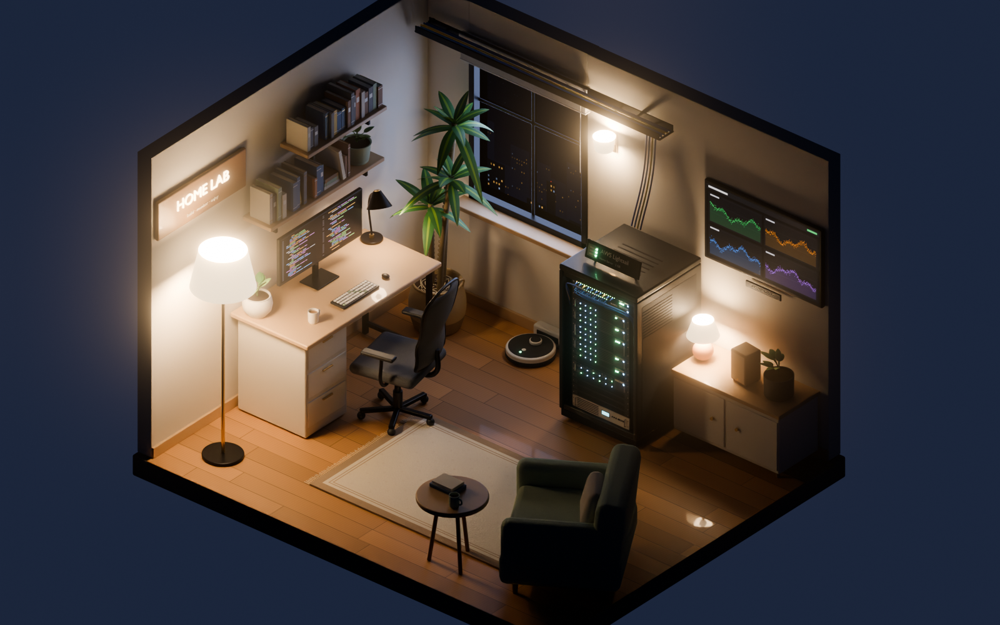
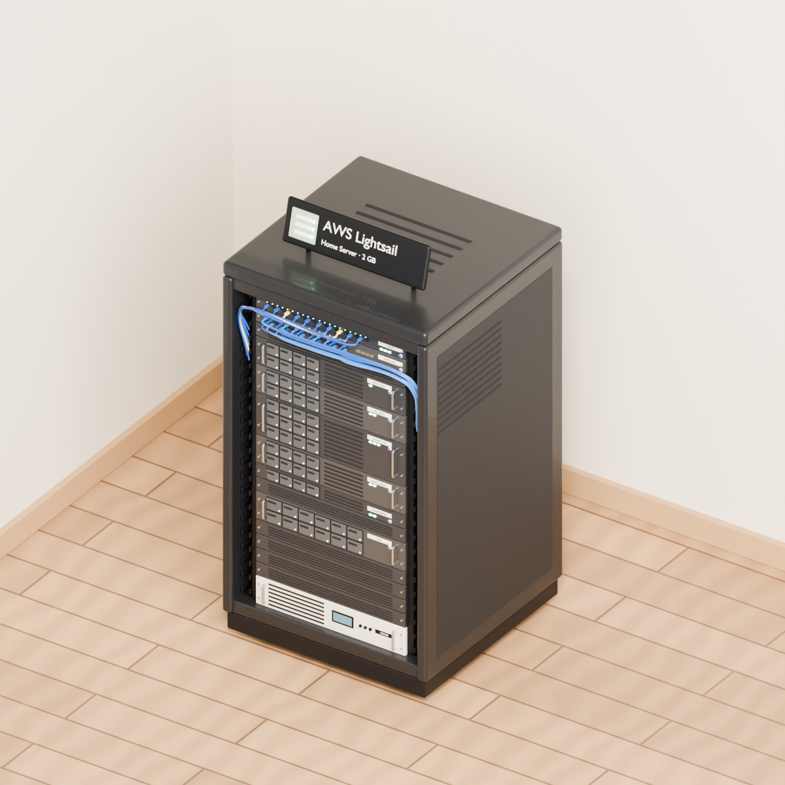
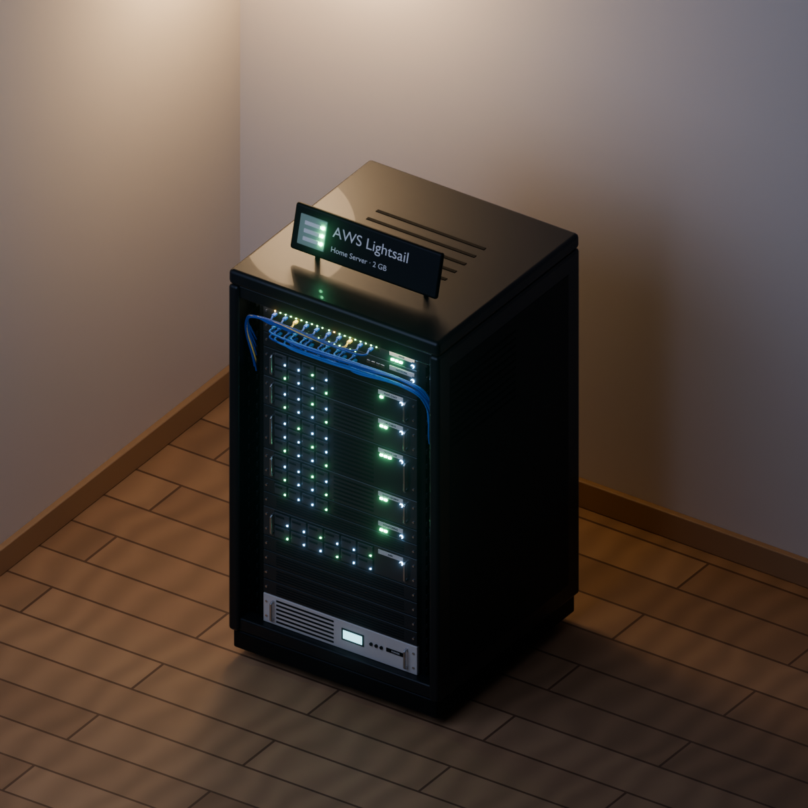
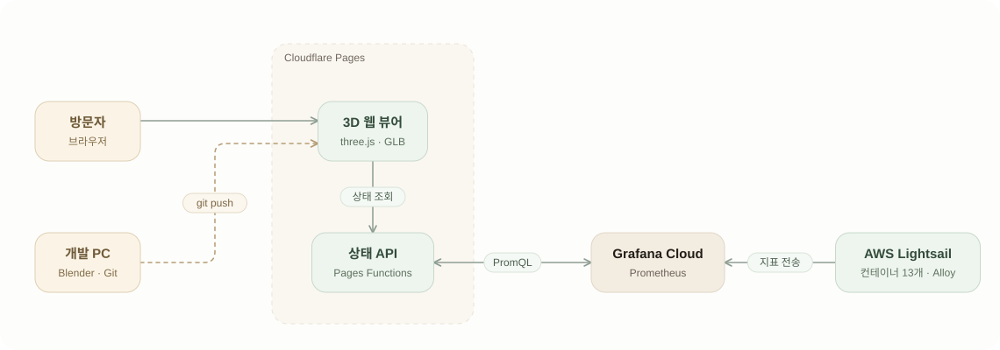

# Home Server 3D

AWS Lightsail 서버 한 대를 작은 3D 서버실로 꾸민 웹 페이지입니다. 방 안 랙에 꽂힌 장비의 LED가 실제 컨테이너 상태에 따라 켜지기 때문에, 서버가 지금 어떤지 한눈에 볼 수 있습니다.

<p align="center">
  <a href="https://server.portfolio-hub.dev"></a>
  <br>
  <sub>실제 서버 상태가 1분 단위로 반영됩니다. 주소 뒤에 <code>?demo=1</code>을 붙이면 예시 데이터로 볼 수 있습니다.</sub>
</p>

| 낮 | 밤 |
| --- | --- |
|  |  |
|  |  |

## 무엇을 볼 수 있나요

- **랙 하나가 서버 한 대입니다.** 랙에 꽂힌 장비 하나가 서비스 하나이고, 장비의 LED 하나가 컨테이너 하나입니다.
- **LED 색이 컨테이너 상태입니다.** 정상은 초록, 주의는 주황, 오류는 빨강, 데이터가 없으면 회색으로 켜집니다. 데이터가 없을 때 정상으로 칠하는 일은 없습니다.
- **오른쪽 패널**에서 CPU·메모리·디스크 사용률과 서비스별 상태를 볼 수 있습니다. 서비스를 누르면 카메라가 랙으로 다가갑니다.
- **낮과 밤**은 보는 사람의 시각에 맞춰 바뀝니다(오전 6시~오후 6시는 낮). 버튼으로 직접 바꿀 수도 있습니다.
- 서버 밖에서 돌아가는 서비스(Grafana Cloud, Sentry)는 랙에 넣지 않고, 벽 모니터와 태블릿 화면으로 표현했습니다.

## 구성

<picture>
  <source media="(prefers-color-scheme: dark)" srcset="docs/architecture-dark.svg">
  
</picture>

- 3D 장면은 Blender Python 스크립트로 만들어 GLB 파일로 내보내고, 웹에서는 three.js로 띄웁니다.
- 상태 API가 Grafana Cloud에서 서버 지표를 읽어 컨테이너마다 정상·주의·오류만 남겨 돌려줍니다. 조회 토큰과 실제 서버·컨테이너 이름은 브라우저로 나가지 않습니다.
- 조회 결과를 1분 동안 캐시하므로, 방문자가 많아도 Grafana Cloud를 부르는 횟수는 늘지 않습니다.
- 이 프로젝트를 위해 서버에 따로 설치한 것은 없습니다. 원래 쓰던 모니터링(Grafana Alloy)이 보내는 지표를 그대로 읽습니다.
- 구성도의 원본 데이터는 [docs/architecture.json](docs/architecture.json)입니다.

## 기술 스택

| 구분 | 사용 기술 |
| --- | --- |
| 3D 제작 | Blender 5.2 (Python 스크립트로 장면 생성, Cycles 렌더) |
| 3D 파일 | glTF(GLB), Draco 압축 |
| 웹 | three.js 0.170, HTML, CSS, JavaScript (빌드 도구 없이 ES 모듈과 import map) |
| 상태 API | Cloudflare Pages Functions, Cache API |
| 모니터링 데이터 | Grafana Cloud (Prometheus, PromQL), Grafana Alloy, cAdvisor |
| 배포 | Cloudflare Pages (GitHub에 push하면 자동 배포) |
| 개발 도구 | Node.js, Wrangler, Git / GitHub |

## 폴더 구조

```
blender/     3D 장면을 만드는 Blender Python 스크립트
assets/      내보낸 GLB와 텍스처
web/         웹 뷰어 (three.js, 정적 파일)
functions/   상태 API (Cloudflare Pages Functions)
shared/      장비·컨테이너 목록 (Blender, 웹, 상태 API가 함께 읽음)
docs/        설계 기록, 구성도, 렌더 이미지
```

## 로컬에서 실행하기

먼저 GLB·텍스처와 장비 목록을 `web/data/`로 복사합니다.

```bash
node web/sync.mjs
```

웹 뷰어만 볼 때는 `web/`을 아무 정적 서버로 띄우면 됩니다. 상태 API가 없으면 예시 데이터로 표시됩니다.

```bash
npx serve web
```

상태 API까지 함께 띄우려면 저장소 루트에서 Wrangler를 실행합니다. 실제 값을 받으려면 `.dev.vars.example`을 `.dev.vars`로 복사해 Grafana Cloud 읽기 전용 토큰을 넣어야 합니다. 토큰이 없으면 모든 LED가 회색으로 나옵니다. 어느 경우든 주소에 `?demo=1`을 붙이면 예시 데이터를 볼 수 있습니다.

```bash
npx wrangler pages dev
```

## 3D 장면 다시 만들기

Blender 5.2를 화면 없이 실행합니다.

```bash
blender -b --factory-startup --python blender/build_room.py -- --theme day --out renders/room_day.png --glb assets/scene.glb
```

밤 렌더는 `--theme night`로 만듭니다. 랙만 따로 만들 때는 `blender/build_rack.py`를 씁니다.

설계하면서 정한 내용은 [docs/design.md](docs/design.md)에 정리해 두었습니다.
